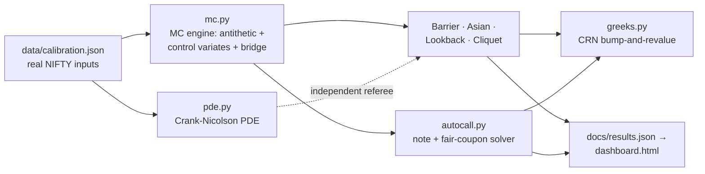

# Exotics & Structured Products Lab


**Path-dependent options and an autocallable structured note, priced the way a derivatives desk prices them: a variance-reduced Monte Carlo engine, an independent finite-difference PDE as referee, bump-and-revalue Greeks on common random numbers — and every number calibrated to real NIFTY market data.**

Barrier, Asian, lookback and cliquet options; a 3-year autocallable reverse convertible with a fair-coupon solver and issuer-margin decomposition; and the model-risk analysis (monitoring bias, grid vs simulation disagreement, sign-flipping deltas) that separates structuring from spreadsheet pricing.

> **Headline, from the real NIFTY calibration of 3 Nov 2026** (full studies in [docs/CASES.md](docs/CASES.md)):
> a 3-month ATM up-and-out call with the barrier 10% away costs **70.2% less** than its vanilla twin (265.21 vs 890.86 pts) — and its delta at spot is **+0.015 against the vanilla's +0.583**, turning **−0.18** into the barrier while its vega flips to **−28.6 pts/pt**. The 3-year quarterly autocall (100% / 70% / 60%) solves to a **fair coupon of 7.11% p.a.**; marketed 100bp lower it leaves the issuer **0.71 pts** of margin. Monte Carlo and the PDE agree to **0.026 vol points** across the strike grid.

## Quickstart

```bash
pip install -r requirements.txt        # numpy, pandas, scipy (+ pytest for tests)
python main.py                         # Cases A/B/C on the real calibration (~1 min)
python tools/build_dashboard.py        # regenerates docs/dashboard.html
python -m pytest tests -q              # 29 tests
```

Open `docs/dashboard.html` — a self-contained dark dashboard (payoff diagrams, discount curve, delta-near-barrier chart, autocall probability profile; works offline, no CDN).

## What's inside

| Module | Contents |
|---|---|
| `src/exotics/mc.py` | Monte Carlo engine: antithetic variates, regression **control variates**, **Brownian-bridge barrier correction** (Broadie–Glasserman–Kou), chunked path generation. Pricers: European, Asian (arithmetic + geometric), up/down-and-out barriers, floating-strike lookback, cliquet. Every price returns `(price, standard error)` |
| `src/exotics/pde.py` | Crank–Nicolson finite-difference solver in log-spot with Rannacher start-up; the barrier enters as a **boundary condition**, not a payoff hack. The independent cross-check for the MC engine |
| `src/exotics/autocall.py` | Autocallable reverse-convertible pricer: quarterly observations, autocall / coupon / knock-in barriers, **fair-coupon bisection to par**, exact leg decomposition (redemption + coupon annuity), event probabilities, expected life |
| `src/exotics/greeks.py` | Bump-and-revalue Greeks with **common random numbers** — delta/gamma/vega for barriers, the vanilla anchor, and the note (spot bumps applied as exact ratio-path shifts) |
| `src/exotics/bs.py` | Black–Scholes–Merton + **Kemna–Vorst** geometric-Asian closed form (the control variate and validation anchor) |
| `src/exotics/calibration.py` | Loads `data/calibration.json` — no market input is hard-coded at a call site |
| `docs/CASES.md` | Three case studies on the real calibration (below) |
| `tests/` | 29 tests: parity, MC within 3 SE of closed forms, barrier limits, discrete-vs-continuous monitoring bias, PDE↔MC agreement, autocall contractual extremes, CRN Greeks vs analytic |

## The maths

**Brownian-bridge barrier correction.** A barrier checked only at simulation dates is missed between dates, and the error is one-sided (the option is overpriced). For a step (Sᵢ, Sᵢ₊₁) with both endpoints below an upper barrier H, the exact conditional crossing probability of the Brownian bridge is

$$p_i = \exp\!\Big(\frac{-2\,\ln(H/S_i)\,\ln(H/S_{i+1})}{\sigma^2 \Delta t}\Big), \qquad V = e^{-rT}\,\mathbb{E}\Big[\text{payoff} \times \prod_i (1 - p_i)\Big].$$

Measured on this repo's base case: discrete monitoring on a 63-step grid overprices the 1.10× barrier by **14.4%** (300.88 vs 263.11 bridge-corrected). The PDE, which has no monitoring grid, sides with the correction (263.77).

**Control variates.** The arithmetic Asian is priced against the geometric Asian on the same paths, whose exact Kemna–Vorst price uses the discrete-fixing moments E[ln G] and Var[ln G] = σ²T(N+1)(2N+1)/(6N²). Same paths, same seed: standard error **0.743 → 0.012**, a 63× reduction, for free.

**Autocall fair coupon.** On a fixed path set the note's price is exactly affine in the coupon, price(c) = A + B·c, with A = 94.97 (redemption leg net of the knock-in loss leg) and B = 70.74 (PV of a unit coupon annuity) — so the bisection solver's answer, 7.11%, is verified by the closed form (100 − A)/B to 1e-4. Structuring insight included: A itself splits into a certain-par redemption leg of 95.18 minus a knock-in (down-and-in put) leg of just **0.21** — so of the 5.03 points of coupon PV at fair, **4.82 points are pure discounting** (money back early, funded at 6.5%) and only 0.21 is payment for the option the investor sells. Under flat-vol GBM the investor is barely paid for the tail; under the real skewed smile that 0.21 multiplies — which is precisely where these notes transfer value, and the decomposition makes it visible.

**Greeks by CRN.** Bump-and-revalue with fresh random numbers prices the noise, not the bump. Every bumped run here reuses the identical seed, so differences are pure bump response — the MC vanilla delta lands within 0.001 of the analytic Black–Scholes delta, and the barrier's negative gamma (−1.19e-04) and negative vega (−28.6/pt) are measured, not asserted.

## Architecture



## Case studies (docs/CASES.md)

- **Case A — the knock-out discount.** 3m ATM up-and-out call across seven barrier levels: −99.9% at 1.02× spot to −0.8% at 1.30×. The delta ladder at H = 1.10× shows price peaking *at today's spot*, delta collapsing +0.10 → −0.18 into the barrier, gamma and vega sign-flipped versus the vanilla — the quantified reason barrier hedging breaks vanilla intuition.
- **Case B — the autocallable a bank would actually sell.** Fair coupon 7.11% p.a. on real-calibrated vol; P(autocall in year 1) 79.4%, P(capital loss) 0.57% with a 45.2% loss given loss, expected life 0.78y; issuer margin 0.71 pts at a marketed 6.11%; stresses (vol +5 → 98.10, spot −10% → 97.81); and the mandatory skew caveat — flat-vol GBM underprices the knock-in tail that the real smile prices several points higher.
- **Case C — model agreement.** MC vs PDE on the barrier across four strikes: max disagreement 1.23 pts = **0.026 vol points**, inside MC error everywhere; the Asian closed form validates the control variate (0.2 SE); monitoring bias measured at 14.4%.

## Calibration provenance

| Input | Value | Source |
|---|---|---|
| NIFTY spot | 23,810.85 | `UndrlygPric`, NSE F&O bhavcopy, 3 Nov 2026 |
| Vol σ | 15.34% | ATM IV, same file (expiry 9 Nov 2026, K = 23,800; CE 10.76% / PE 19.92% averaged) |
| Realised vol | 11.8–15.8% | yfinance `^NSEI`, 21d–252d windows + EWMA(0.94) 14.97% |
| Rate r / dividend q | 6.5% / 1.3% | Stated assumptions (see `data/PROVENANCE.md`) |

One flat vol is used for *all* cases so MC, PDE and closed forms compete on identical inputs; the autocall is additionally stressed at σ + 5 pts, spanning the observed term structure (13.0–18.2%).

## Model risk & limitations

- **Flat-vol GBM.** No smile, no jumps, no stochastic vol. This *understates* knock-in tail risk (Case B says so in numbers) and misprices deep-wing payoffs. The engines are built so a Heston/local-vol dynamics can replace the GBM path generator without touching the payoff layer — that is the stated next step, not a silent gap.
- **Bridge correction is an approximation** of continuous monitoring (exact conditional crossing law, approximate payoff interaction); the PDE cross-check bounds the residual (≤ 0.07 vol pts across all reported barriers).
- **Autocall simplifications, all stated:** single underlying (no worst-of correlation), **non-memory** coupons, European (maturity-only) knock-in observation, single-curve discounting (no issuer credit / funding spread), no early-call issuer option beyond the contractual autocall. Each one moves the fair coupon; the decomposition shows exactly where a richer term sheet would bite.
- **Calibration is one day** (3 Nov 2026) and the ATM IV averages a CE/PE pair whose settlement prints break put-call parity (measured in the sibling `greeks-lab` repo). It is a real print, not a clean one — which is the normal state of market data.

## Disclaimer

Research and education code. Prices are model values under stated assumptions, not quotes; structured products embed issuer credit, fees and liquidity costs that this lab isolates deliberately. Not investment advice.
